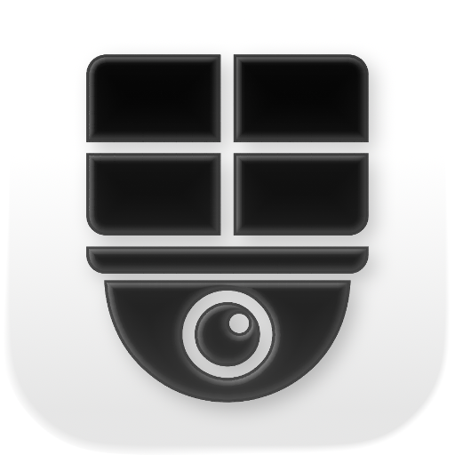
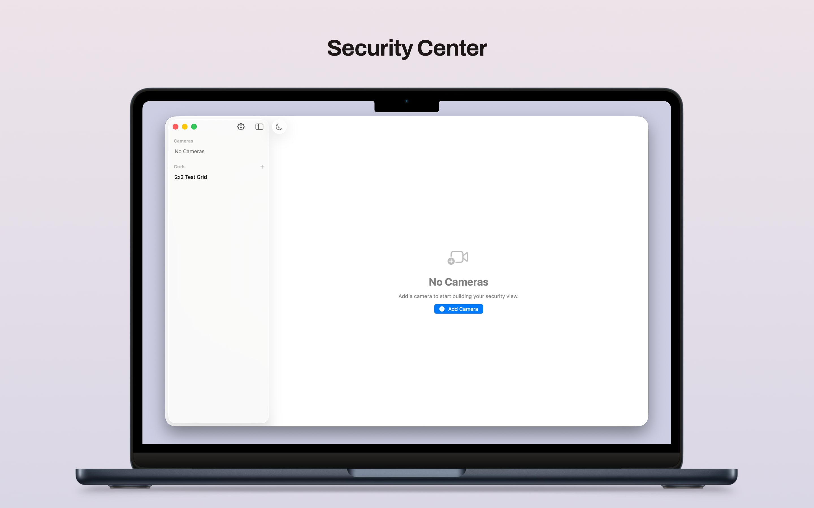
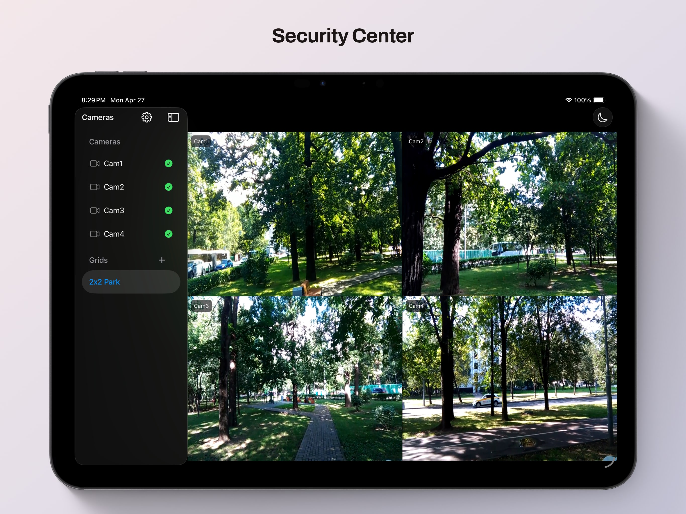

<div align="center">

<picture>
  <source srcset="docs/icon-dark.png" media="(prefers-color-scheme: dark)">
  <source srcset="docs/icon-light.png" media="(prefers-color-scheme: light)">
  
</picture>

## Security Center

Native camera monitoring for macOS and iOS.

[Website](docs/index.html) ·
[Support](docs/Support.html) ·
[Privacy](docs/PrivacyPolicy.html)

</div>

<p align="center">
  <a href="docs/mac1.jpg"></a>
  <a href="docs/iPad1.jpg"></a>
</p>

Security Center brings Reolink snapshot feeds and RTSP streams into one native app, with saved grids, quiet hours, local import and export, and settings that stay understandable.

Built for people who want a direct, local way to monitor cameras without turning setup and day-to-day use into a maintenance project.

## Features

- Reolink JPG and RTSP in one app, plus generic RTSP support
- Saved grids with camera assignment and sidebar switching
- Sidebar availability checks for enabled cameras
- Quiet hours that black out the screen and pause polling, streaming, and probing
- Per-camera editing for names, source settings, stream selection, mute, copy, disable, and validation
- Local JSON import and export for moving configuration between installs
- Theme and view background settings
- Native macOS Settings window with General, Quiet Hours, Cameras, Grids, and Configuration tabs (⌘,); preferences save immediately
- Shared SwiftUI app for macOS and iOS with platform-specific settings flows
- Local-first setup: camera traffic goes directly to the endpoints you configure


## Camera Modes

| Type | Feed Options |
| --- | --- |
| Reolink Camera | `Reolink JPG`, `RTSP` |
| Generic RTSP Stream | `RTSP` |

## Platforms

- macOS 15.0 or later
- iOS 18.0 or later
- Built with SwiftUI and `VLCKitSPM`

## What It Stores

Security Center stores its app state locally in `UserDefaults`, including:

- Cameras
- Saved grids
- Grid assignments
- Grid picture style
- Theme and view background
- Selected sidebar item
- Quiet hours

## Privacy

Privacy details live in [docs/PrivacyPolicy.html](docs/PrivacyPolicy.html).

## Work In Progress

I am continuing to work on improving performance of the iOS branch. Once I am happy with the results, it will be submitted to the App Store for release.

## Changelog

### 1.1.0
- Redesigned macOS Settings with dedicated General, Quiet Hours, Cameras, Grids, and Configuration tabs.
- Simplified camera editing with Connection, Picture & Sound, and Display pages, plus a Check Connection button.
- Added matching Edit, Copy, and Delete camera buttons with clearer click feedback.
- Added a camera “+” button to the sidebar. Camera and grid editors now work consistently from the sidebar and Settings.
- Added grid management with layout editing and camera assignments. Grid picture shape now lives in the Grids tab.
- Redesigned configuration import with a separate selection window, category tabs, and switch controls.
- Added options to remove all cameras or reset grids.
- Added optional blurred camera backgrounds for JPG and RTSP feeds.
- Added ⌘⇧M to toggle Quiet Hours.
- Reduced unnecessary audio processing for muted RTSP streams.
- Added optional debug logging to help investigate streaming issues.

### 1.0.1
- Added "Keep Screen Awake" setting. Screen is kept awake by default when streaming, but would go to sleep during Quiet Hours. This setting prevents that.

### 1.0.0
- Initial macOS release. iOS works, but you have to compile yourself.
### Streaming debug logs

On macOS, open Settings → General → Diagnostics and turn on **Enable Debug Logging**. It takes effect for streams that are already playing and stays enabled across app restarts. When a glitch occurs, note the approximate time, then use **Show Logs in Finder** to collect `stream-debug.log` and its numbered archives. On iOS, the same option is in Settings → Diagnostics; tap Done to apply it and use **Share Debug Log** to share the active file.

Logs contain camera names, endpoints, playback/reconnect events, native VLC decoder messages, and frame statistics sampled every five seconds. Credentials, authentication headers, and full camera URLs are redacted before writing. The active file and three archives each hold up to 5 MB, retaining approximately 20 MB total. Turning logging off stops recording and preserves existing files. This preference stays on the device and is not included in configuration exports.

Logger regression checks can be run from the repository root:

```sh
xcrun swiftc -module-cache-path /tmp/securitycenter-log-test-cache 'Security Center/Logic/StreamDebugLog.swift' Tests/StreamDebugLogTests.swift -o /tmp/securitycenter-stream-log-tests
/tmp/securitycenter-stream-log-tests
```

Muted RTSP cameras skip audio processing entirely. Changing mute briefly reconnects the stream to apply the new audio mode. Diagnostic samples identify `audioProcessing=disabled` or `enabled` and report `audioDecoded`/`audioPlayed` counters so audio timing changes can be compared with a saved baseline.

### RTSP stall recovery

RTSP playback checks rendered-frame progress every two seconds, independently of debug logging. It allows 30 seconds for initial video and reconnects after 20 seconds without new displayed frames once playback has started. Brief stalls and static scenes do not trigger recovery as long as frames continue arriving. Checks pause for hidden/minimized or inactive viewers and give a fresh allowance after a long sampling gap. Quiet hours and disabled cameras remove their players and stop the checks.

Watchdog recovery reopens the existing camera connection using the normal reconnect delay. When logging is enabled, look for `frame watchdog detected stalled video` followed by `reconnect executing`.

Run the deterministic recovery checks from the repository root:

```sh
xcrun swiftc -module-cache-path /tmp/securitycenter-watchdog-test-cache 'Security Center/Logic/RTSPFrameWatchdog.swift' Tests/RTSPFrameWatchdogTests.swift -o /tmp/securitycenter-watchdog-tests
/tmp/securitycenter-watchdog-tests
```
